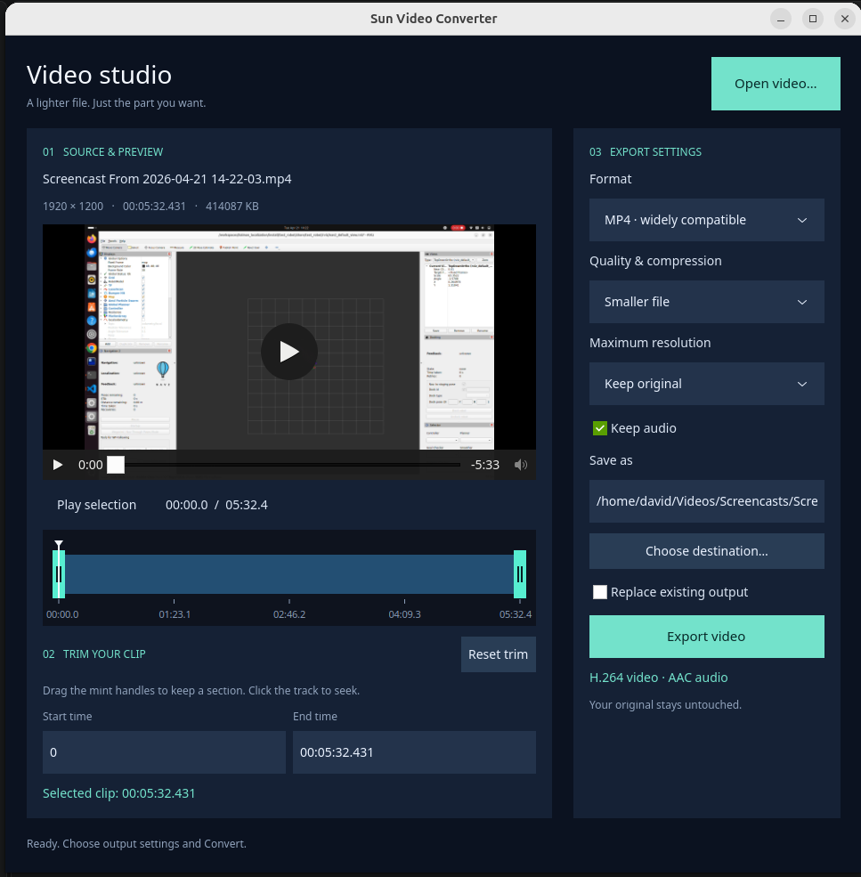

# sun_video_editor



## Overview

Local video editing and screen capture for Ubuntu and macOS.

- **Video Editor:** trim, cut out sections, convert, and compress videos. Export
  to MP4, MOV, WebM, MKV, AVI, or animated GIF.
- **Screencast:** capture a screen, window, or selected area as a PNG screenshot
  or MP4 recording, with optional camera and microphone recording.

## Install

### macOS

Apple Silicon with macOS 26 (Tahoe) or newer.

Download the `.dmg` from the [development release](https://github.com/namo-robotics/sun_video_editor/releases/tag/dev),
open it, and drag **Sun Video Editor** to **Applications**. The app includes its
media tools and libraries; Homebrew is not required.

For an unnotarized development build you trust, macOS may require **System
Settings > Privacy & Security > Open Anyway** after the first launch attempt.

### Ubuntu

Ubuntu 26.04, x86_64:

```sh
curl -fL --output sun-video-editor-dev.deb \
  https://github.com/namo-robotics/sun_video_editor/releases/download/dev/sun-video-editor_0.1.0_amd64.deb &&
  sudo apt install ./sun-video-editor-dev.deb &&
  sun_video_editor
```

These are development releases. Installation includes the required media dependencies.

## Build from source

Use Ubuntu 26.04 (x86_64) or macOS 26+ (Apple Silicon), with the
[Sun compiler](https://github.com/namo-robotics/sun) installed. macOS also requires
Homebrew and Xcode Command Line Tools. On Ubuntu, you can use the repository's
[VS Code development container](.devcontainer/README.md), which includes the compiler.

From the repository root, install dependencies, build, test, and run:

```sh
./scripts/install-dependencies.sh
./build.sh
./build/sun_video_editor
```

To create an installable package:

- **Ubuntu:** run `./build.sh --package`, then install on your desktop with
  `sudo apt install --reinstall ./build/sun-video-editor_0.1.0_amd64.deb`.
- **macOS:** run `./scripts/package-macos.sh`, then open the generated `.dmg` in
  `build/` and drag the app to Applications.

See the [development guide](docs/development.md) for setup details and build options.

### Configured build scripts

The editor entrypoint uses `scripts/generate_view.sh` followed by
`scripts/build_editor.sh`. Sun resolves its declared dependencies before running
the scripts and provides the selected target and artifact paths through the build
context. The scripts query dependency roots with `sun dependency-path` and invoke
`sun build-compile` to preserve compiler settings. Linux and macOS capture targets
use `scripts/build_capture.sh` and `scripts/build_capture_macos.sh`, respectively.

These entrypoints can be built through the standalone `sun-config.json` or an
including config. Included local providers take precedence over downloaded
packages. Use a compiler that supports the `build` script array.

### Dependency release URLs

`sun-config.json` selects published `.sun.tar.gz` package URLs for Linux x86_64
and Apple Silicon macOS. Sun resolves and validates the packages, including
`sun_viewc`, the moons, and any separate native libraries. The moons carry the
native archives needed by the editor and capture helper.

`./scripts/install-dependencies.sh` installs system tools, resolves the configured
URLs, and retains license notices for packaging. The build uses the same resolver
and defaults to `build/dependencies/cache`; `SUN_DEPENDENCY_CACHE` can select a
different cache. Dependency URLs have no pinned hashes and are refreshed when
resolved. Change release URLs in the config to select another release.
