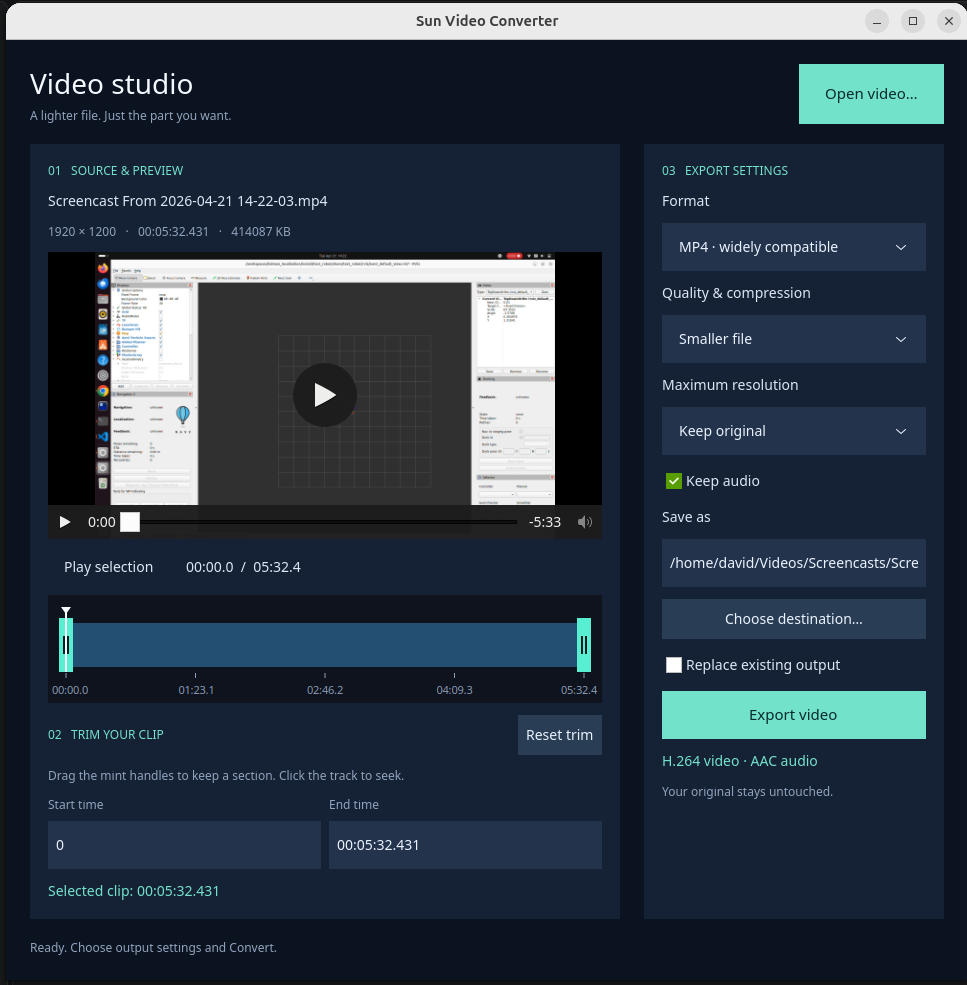

# sun_video_editor

Two tools for local video work:

- **Video Editor:** trim, convert, and compress videos. Export to MP4, MOV, WebM,
  MKV, AVI, or animated GIF.
- **Screencast:** capture a screen, window, or selected area as a PNG screenshot
  or high-quality silent WebM recording at the source resolution, with an optional
  delay, image previews, and recording playback. Screenshots use lossless PNG.

Captures request screen-sharing authorization. Choose the source first; the delay
then runs before the screenshot or recording starts.

Video editing supports Ubuntu and macOS. Screencast requires Ubuntu with PipeWire
and desktop portal support; audio recording is not yet supported.



## Install

### macOS

Apple Silicon with macOS 26 (Tahoe) or newer. Requires [Homebrew](https://brew.sh).

```sh
brew install namo-robotics/sun/sun-video-editor
sun_video_editor
```

### Ubuntu

Ubuntu 26.04, x86_64:

```sh
curl -fL --output sun-video-editor-dev.deb \
  https://github.com/namo-robotics/sun_video_editor/releases/download/dev/sun-video-editor_0.1.0_amd64.deb &&
  sudo apt install ./sun-video-editor-dev.deb &&
  sun_video_editor
```

These are development releases. Installation includes the required FFmpeg 8+ dependencies.

## Build from source and install locally

### Ubuntu 26.04, x86_64

Open a checkout of this repository in VS Code and select **Dev Containers:
Reopen in Container**. The development container provides the Sun compiler,
native build dependencies, FFmpeg 8+, and test tools. The editor uses published
`sun_ui` and `sun_gobject` releases; no dependency source checkouts are needed.

From the editor repository root, either on Ubuntu directly or inside the
container, install the dependencies and build the local Debian package:

```sh
./scripts/install-dependencies.sh
./build.sh --package
```

The dependency installer installs missing system packages with `apt-get`, using
`sudo` when needed. These include GTK development files, build and packaging
tools, FFmpeg, GStreamer plugins, and headless test tools. It requires FFmpeg
and ffprobe 8 or newer. Already installed packages are left in place.

It also extracts the published Debian packages into `build/dependencies/`,
including `sun-viewc` from the `sun-ui` package. Compiler version differences
are informational; Sun checks bundle compatibility during the build. No
dependency sources are built. The default release tag is `dev`; `SUN_UI_RELEASE` and
`SUN_GOBJECT_RELEASE` can select another tag with the same asset names.

The package command builds the editor and runs its media and desktop acceptance
tests before creating `build/sun-video-editor_0.1.0_amd64.deb`.

On your Ubuntu desktop, outside the container, open a terminal in the same
repository directory and install the package:

```sh
sudo apt install --reinstall ./build/sun-video-editor_0.1.0_amd64.deb
sun_video_editor
```

`--reinstall` also installs a rebuilt package when its version is unchanged.
Close any running editor before launching the updated build. Installation adds
the application launcher and required runtime dependencies.

For development without installation, build and test with `./build.sh`, then
run `./build/sun_video_editor` in a desktop session with the required libraries.

For macOS source builds and further setup details, see the
[Development and release guide](docs/development.md).

## Shared development container

See [.devcontainer/README.md](.devcontainer/README.md) for the applied Sun template
version, project-specific settings, and rebuild instructions.
